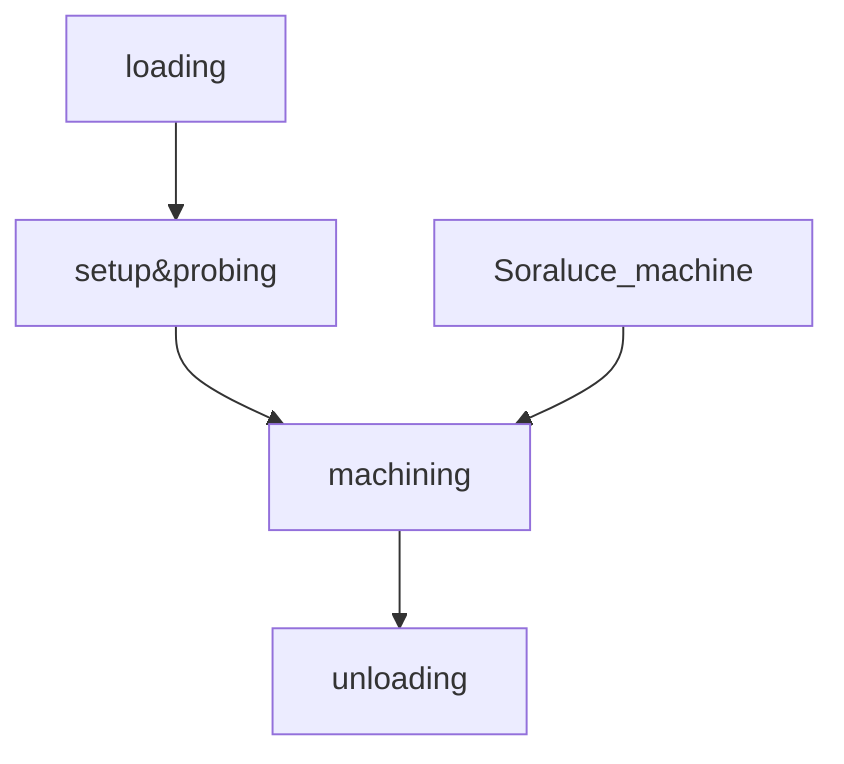

# Komatsu use case

Extension boom (PC490-11 K100) part of an excavator.

this is how Komatsu describes it, but from our perspective probably the machining is the only one that is relevant.

The workpiece is machined using two Soraluce FLP machines (FLP 7152 and FLP 7153) facing each other in a single setup. There are 46 operations.

